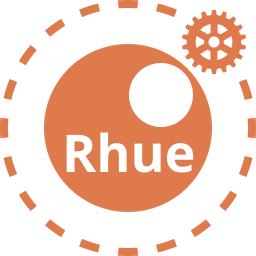

<div align="center">
  
  <h1>rhue-derive</h1>
  <p><code>#[derive(UserData)]</code> for Rhue, so a Rust struct can be a script object.</p>
  <p>
    <a href="https://crates.io/crates/rhue-derive"></a>
    <a href="https://docs.rs/rhue-derive"></a>
    <a href="https://github.com/rhuelang/rhue/actions/workflows/ci.yml"></a>
    <a href="https://www.rust-lang.org"></a>
    <a href="https://github.com/rhuelang/rhue#-license"></a>
  </p>
</div>

Use it through the `rhue` crate, it's re-exported there as `rhue::UserData`. You don't need to depend on this one yourself.

```rust
use rhue::{Engine, UserData};

#[derive(UserData, Clone)]
struct Player {
    name: String,
    hp: f64,
    #[rhue(readonly)]
    id: u32,
    #[rhue(skip)]
    secret: String,
}

let mut engine = Engine::new();
engine
    .register_type::<Player>()
    .method("heal", |p: &mut Player, amount: f64| p.hp += amount);
engine.set_global("player", Player { name: "Aalto".into(), hp: 50.0, id: 7, secret: String::new() });
engine.eval("player:heal(25) player.name ..= '!'").unwrap();
```

Every named field turns into a property scripts can read and write, and the type checker knows about all of them. The field types have to be `Clone + IntoValue + FromValue`.

- `#[rhue(readonly)]` — scripts can read it but not assign it
- `#[rhue(skip)]` — scripts can't see it at all
- `#[rhue(name = "...")]` — a different name in scripts, on a field or on the struct itself

Generic structs, enums and tuple structs aren't supported, implement `UserData` by hand for those.

## License

MIT or Apache-2.0, same as the rest of Rhue.
