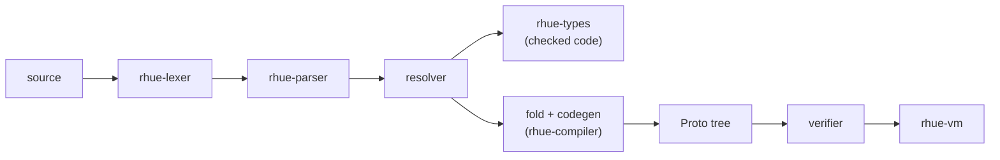

# How Rhue works

The short version, as things are now. [`DESIGN.md`](DESIGN.md) has the long version in milestone order, with the reasons and the numbers behind each decision.

## From source to running

- **Lexing and parsing.** Luau syntax, types included, into an AST where every node has a byte span. Sources over 4 GiB get refused up front, which is why spans fit in a `u32`. Nesting is capped at 1000 deep.
- **Resolving.** Every name becomes a local or a global in a side table, and captured locals get marked so the compiler knows where upvalues need closing.
- **Checking.** `--!strict` and `--!nonstrict` code goes through `rhue-types`. Types get checked and then thrown away, nothing about them reaches the bytecode. Strict code with a type error doesn't run.
- **Compiling.** One pass, folding constants on the way. Locals live in registers, at most 250 per function. Instructions are 32 bits: the opcode in the low byte, then `A`, `B` and `C`, or a 16-bit `Bx`.
- **Verifying.** Every `Proto` gets checked before it runs, compiled here or loaded from bytes: operands in range, jumps landing on real instructions, registers inside the frame. That's what makes loading saved chunks safe.

## The VM

- **Values** are 16 bytes and `Copy`. Numbers are `f64`, vectors are three `f32`s stored inline, and everything else is a handle into the heap.
- **The heap** is generational slabs per kind (strings, tables, functions, userdata, threads, buffers). Strings are interned UTF-8. The collector is mark and sweep with a worklist, runs only at safe points right after an allocating instruction, and triggers at twice what survived last time.
- **Calls** don't recurse in Rust. Each one pushes a 72-byte `Frame` on a heap stack, capped at 10,000 deep, and arguments already sit where the callee's parameters go. Natives get a `NativeCtx` with the whole VM, so they can call back into scripts.
- **Dispatch** works through a fixed 264-slot window over the register stack. It's bounds-checked on every instruction, which costs about 5% on tight loops. That's the price of no `unsafe` anywhere.
- **Tables** have an array part for `1..n` and an insertion-ordered hash part (a plain vector up to 8 entries, an `IndexMap` after). Constructors with constant keys start from a template with the keys already in place.
- **Speed** mostly comes from per-instruction inline caches for field reads, writes and globals, plus shortcuts for common builtins (`type`, `rawget`, `math.floor`, `string.sub`...) that skip the full native call.
- **Coroutines** are threads with their own stacks, swapped into the VM in place when resumed.

## Keeping scripts in line

- **The instruction limit** is charged at backward jumps and calls, so every loop and recursion pays, and in slices of 16,384. Natives that do a lot of work in one call (the pattern matcher, `table.move`, `string.rep`...) charge the same budget, and the matcher counts every attempt.
- **Interrupts** get checked when a slice runs out, so they cost nothing until then.
- **The memory limit** counts what the heap thinks it's holding, so it's a budget, not an exact cap on allocator bytes.
- **`pcall`** can't catch running out of instructions or memory, or an interrupt.

## Around the edges

- **Debugging** goes through a hook on lines, calls and returns. `rhue-dap` builds breakpoints, stepping and evaluation on top of it.
- **Hot reload** swaps the code behind existing function handles, so everything holding one runs the new version, and remaps upvalues so state carries over.
- **The editor side** (`Engine::analyze`, outlines, inlay hints) is behind the unstable `tooling` feature, it's what `rhue-lsp` is built on.
